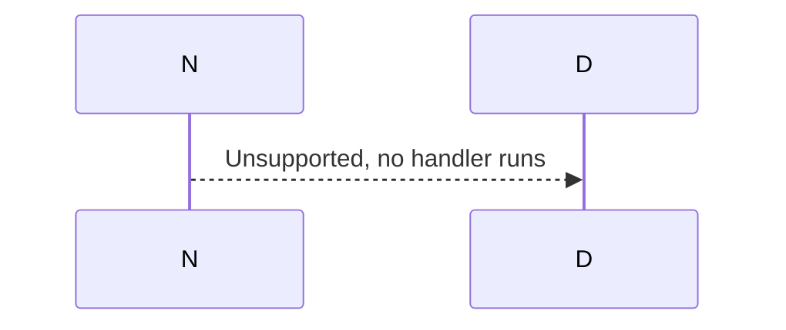
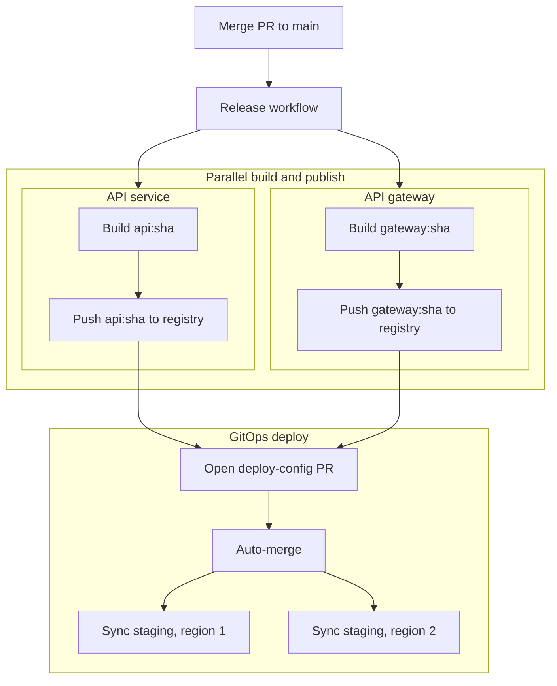

# Mermaid Conventions

Write Mermaid diagrams that render cleanly and stay readable, and check every
diagram with the Mermaid CLI (`mmdc`) before it goes into a document, because
generated diagrams are often invalid or render as an unreadable strip.

**Syntax.** Put each statement on its own line. Use commas or separate
sentences instead of semicolons in labels, messages, and notes; sequence
diagrams treat a raw semicolon as a statement separator and break:



**Layout.** Long single-column chains (`A --> B --> C --> D …`) render tall,
thin, and zoomed out, with tiny text. Group steps into `subgraph`s by phase,
system, or owner, and draw independent steps side by side, fanning out and
back in, so the diagram gets width to balance its depth:



**Validate.** Write the diagram to a unique file under `/tmp/` and render it:

```bash
mmdc -i /tmp/diagram-<id>.mmd -o /tmp/diagram-<id>.png
```

A syntax error exits non-zero and names the line. Then read the PNG and check
the text is legible, nothing is clipped, and the diagram isn't a thin strip.
If `mmdc` is missing, install it with
`npm install -g @mermaid-js/mermaid-cli`.

## Saving an image

Save an image only when the user asks to save one, keep a copy, or put it on
their machine; previewing or validating isn't a request to save. Then:

1. Write the source to `/tmp/mermaid-<id>.mmd` with a fresh random ID, so you
   never overwrite an earlier diagram.
2. Add `fontFamily: "Menlo, monospace"` at the top level of the Mermaid init
   config. Set the font there rather than only in CSS, because Mermaid
   measures text with it before laying out; a CSS-only font can clip labels.
3. Use `theme: "base"` with `themeVariables` for global colours. Global
   variables can't give subgraphs different colours, so use
   `style <subgraph-id>` for each boundary and `classDef` with `class` for
   consistent node boxes.
4. Render with the bundled [mermaid.css](../conventions-mermaid/mermaid.css),
   resolved to an absolute path, and a white background:

   ```bash
   id="$(uuidgen | tr '[:upper:]' '[:lower:]')"
   mmdc --input "/tmp/mermaid-${id}.mmd" --output "/tmp/mermaid-${id}.png" \
     --cssFile "$css" --backgroundColor white
   ```

   For a larger image, add `--scale 2` or `--scale 3`; it raises resolution
   without changing the layout.
5. Read the image to check the text is legible and not clipped, then give the
   user its exact path. Mention that the PNG doesn't hold the source, config,
   or CSS, so reproducing it needs those and a compatible Mermaid version.
