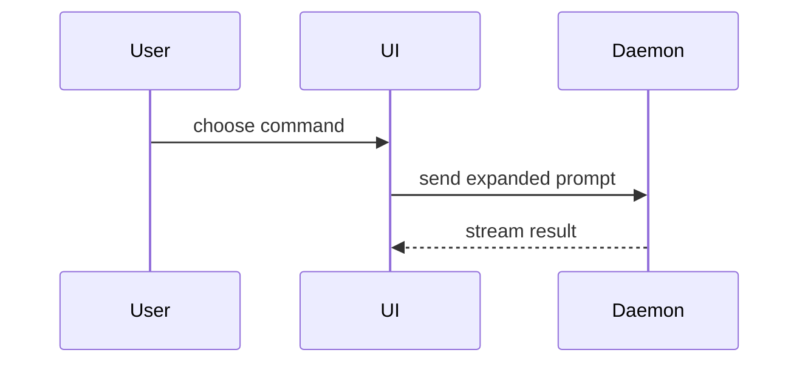

Explain the current topic visually. Skip the preamble, keep prose brief, and
place each visual beside the short text it supports. Use the smallest view—or
few views—that makes the point; most answers need one or two forms, rarely
all. Include only the calls, files, props, states, and boundaries the
question or decision needs.

## Choose a view

**Pseudocode** for logic or an algorithm:

```text
on(save)
  if content is unchanged
    return cached result
  write new content
  return fresh result
```

**Call tree** for runtime control flow:

```text
submitForm
  createSession
    persistPrompt
    launchAgent
  navigateToSession
```

**Component tree** for UI structure, with relevant state and module
boundaries:

```tsx
<SessionPage> (apps/example/src/routes/session.tsx)
  useSessionEvents()
  <SessionToolbar>
    <RunSkillButton> (packages/ui)
```

**Shallow file tree** for file responsibilities or a broad refactor:

```text
src/
├── commands/       # parses user actions
├── sessions/       # owns session state
└── transport/      # sends API requests
```

**Mermaid** for component interaction, control flow, or data flow:



**Diff** when the point is what changes and the surrounding shape already
exists. Choose a component tree, file tree, call tree, or control flow to
diff:

```diff
 submitForm
   createSession
     persistPrompt
+    expandSkillMention
     launchAgent
-  navigateToSession
+  navigateToSession
+    subscribeToEvents
```

**Whole block** when most of it is new, leaving out context would hide
ownership or order, or the user needs a copyable target:

```ts
function expandSkill(command: string): string {
  const skillName = command.slice(1)
  return `use the ${skillName} skill`
}
```

**HTML file** for a visual UI, layout, state comparison, or concept too dense
for Mermaid. Make one focused diagram, infographic, or short slide deck.
Before creating it, load [design](../design/SKILL.md) and its selected theme
and format guidance; preserve an existing product's design system. Use real
labels and data, and support desktop and mobile. Save it as
`show-me-{description}.html` and open it for the user with `open`.
