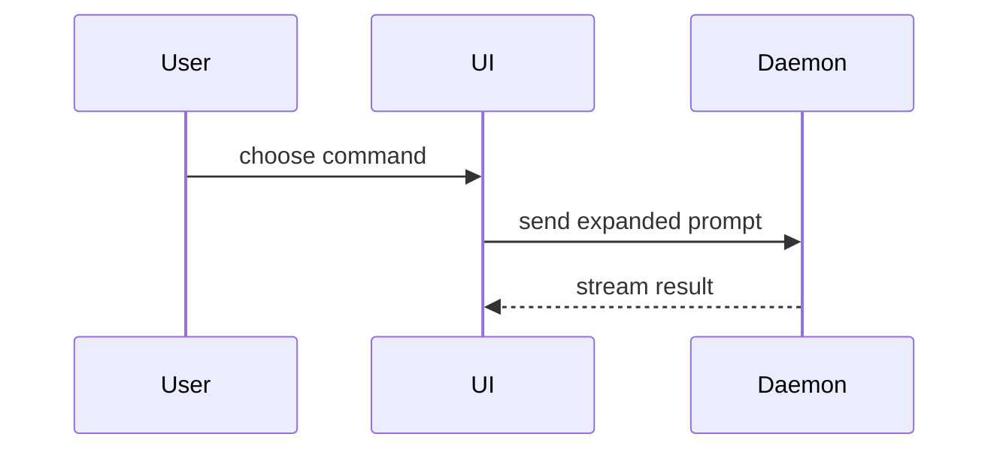

# Show Me

Help the user understand the current topic visually. Skip the preamble, keep
prose brief, and put each visual next to the short text it supports. Pick the
smallest view, or few views, that make the point; most answers need one or
two of the forms below, rarely all. Keep only the calls, files, props, states,
and boundaries the current question or decision needs.

**Pseudocode** for logic or an algorithm:

```text
on(save)
  if content is unchanged
    return cached result
  write new content
  return fresh result
```

**Call tree** for runtime control flow:

```text
submitForm
  createSession
    persistPrompt
    launchAgent
  navigateToSession
```

**Component tree** for UI structure, with the state and module boundaries
that matter:

```tsx
<SessionPage> (apps/example/src/routes/session.tsx)
  useSessionEvents()
  <SessionToolbar>
    <RunSkillButton> (packages/ui)
```

**Shallow file tree** for file responsibilities or a broad refactor:

```text
src/
├── commands/       # parses user actions
├── sessions/       # owns session state
└── transport/      # sends API requests
```

**Mermaid** for component interaction, control flow, or data flow:



**Diff** when the point is what changes and the surrounding shape already
exists. Diff whichever of the forms above fits the topic: a component tree,
file tree, call tree, or control flow.

```diff
 submitForm
   createSession
     persistPrompt
+    expandSkillMention
     launchAgent
-  navigateToSession
+  navigateToSession
+    subscribeToEvents
```

**Whole block** when most of it is new, when leaving out context would hide
ownership or order, or when the user needs a copyable target:

```ts
function expandSkill(command: string): string {
  const skillName = command.slice(1)
  return `use the ${skillName} skill`
}
```

**HTML file** for a visual UI, layout, state comparison, or concept too dense
for Mermaid: one focused diagram, infographic, or short slide deck. Match the
product's colours, type, spacing, and components, use real labels and data,
and make it work on desktop and mobile. Save it as
`show-me-{description}.html` and open it for the user with `open`.
