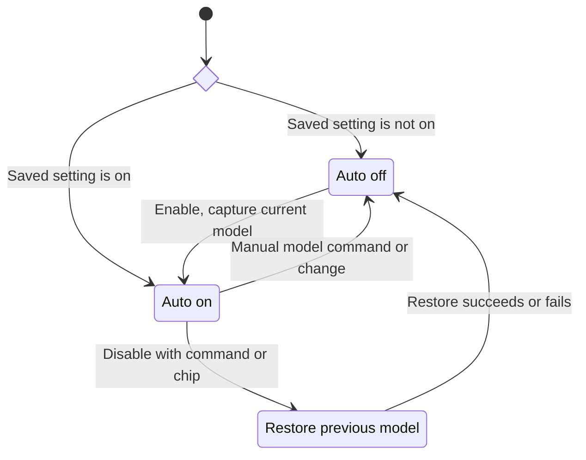
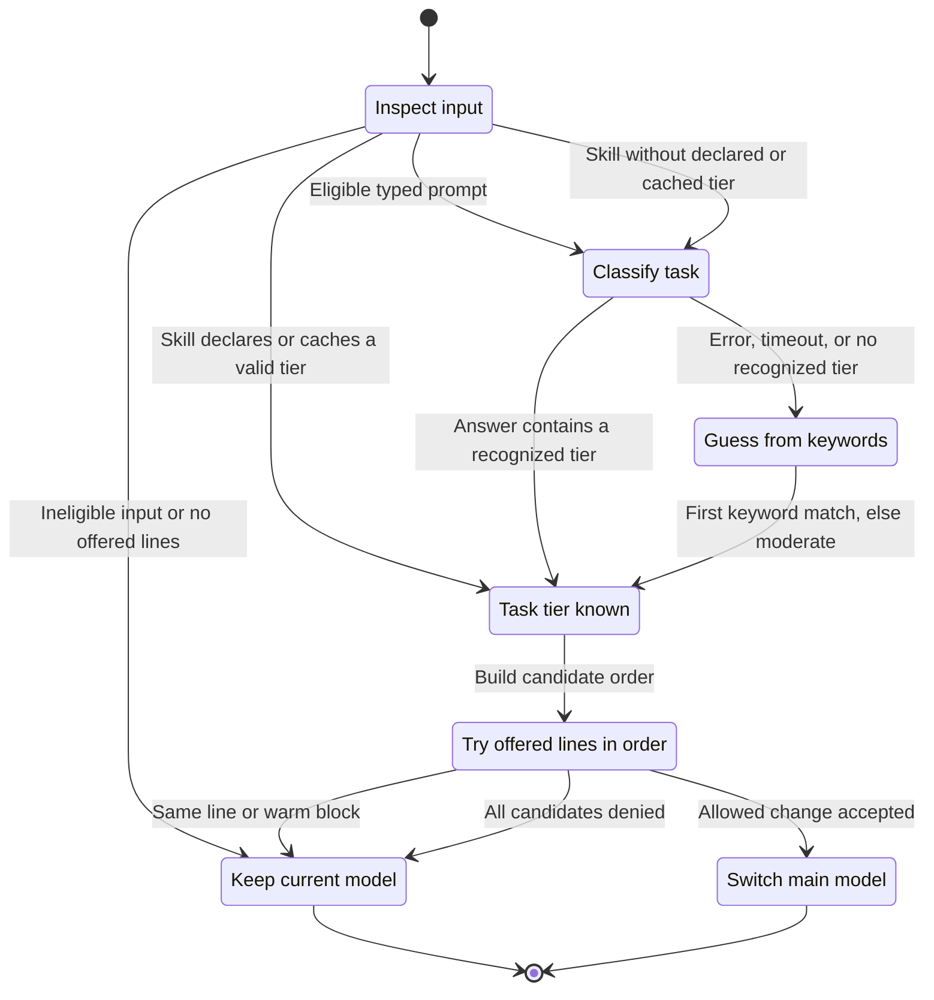

# Model state transitions

Auto Model changes the main conversation's physical model before an eligible
prompt or skill runs. Its on/off setting is separate from the model currently
in use. Effort is not tier-mapped: an independent cap changes `max` to `xhigh`
for every request, including helper agents and requests sent while Auto is off.

## Turning Auto on and off

- `/automodel on` or the footer chip saves the current model for restoration,
  persists Auto as on, and waits for an eligible input. Enabling alone does
  not switch models.
- `/automodel off` or the chip disables Auto, then tries to restore that saved
  model. If its exact identifier is denied, it tries the same model-line
  alias. A failed restoration leaves Auto off and reports the failure.
- A non-plugin `/model` command or model configuration change disables Auto
  **without restoring** the earlier model, so the manual choice wins.
- Session startup restores the on/off preference, but clears the warm-cache
  clock and remembered refused lines. It does not restore the pre-Auto model.

Automatic switches write the model setting as `/model` does. A new session
therefore starts on the last saved model, even when the previous session's
original model was different. Reinstalling the repo's Claude configuration can
reset that setting to the template default.

## Routing one input

This diagram covers automatic routing, not the explicit on/off or manual
selection commands above. Each terminal state ends this routing decision.

### Which inputs can choose a tier?

| Input                                                | Routing rule                                                                                                                                                                                      |
| ---------------------------------------------------- | ------------------------------------------------------------------------------------------------------------------------------------------------------------------------------------------------- |
| Typed composer prompt                                | Classify only while Auto is on, outside an active turn, and after the exclusions below.                                                                                                           |
| User or plugin skill slash command                   | Use valid `metadata.model-tier` from the project's skill file first, then the home skill file. If the first readable file has no valid tier, classify the command's name and description instead. |
| Skill without a declared tier                        | Reuse its cached tier, keyed by command name and description, or classify and cache it. Slash arguments do not affect the tier.                                                                   |
| Acknowledgment or empty text                         | Keep the current model, including before the first turn.                                                                                                                                          |
| Other reply with fewer than four words               | Keep the current model after a main turn has completed. A short first prompt can still be classified.                                                                                             |
| Built-in, MCP, unknown, or `/automodel` command      | No automatic tier selection. Skill commands use the separate skill path.                                                                                                                          |
| Non-composer input, mid-turn prompt, or helper agent | Do not automatically select its model. The effort cap still applies.                                                                                                                              |

For typed prompts, classification removes fenced code, inline code, and quoted
lines so that a mentioned command is not mistaken for the requested action.
If removing those leaves no text, it uses the original input. An absolute file
path is not treated as a slash command.

### Tiers and classifier fallback

| Tier       | Model line | Typical task                                                                      |
| ---------- | ---------- | --------------------------------------------------------------------------------- |
| `trivial`  | `haiku`    | Mechanical work, short writing, factual answers, repo-state checks.               |
| `moderate` | `sonnet`   | Hands-on code changes, debugging, tests, audits, long documents, multi-file work. |
| `complex`  | `opus`     | Specs, plans, research, architecture, code or security review.                    |
| `frontier` | `fable`    | Whole-system redesign, a very large migration, extended deep research.            |

These are aliases offered by the installed `/config` model row, not fixed
version identifiers. The classifier uses the smallest offered line, `low`
effort, up to 12,000 input characters, 8 output tokens, and a 4-second timeout.
It classifies the immediate action rather than the broader project context.

If it fails or gives no recognized tier, the keyword fallback checks in this
order: frontier, repo-state lookup (`trivial`), complex, moderate, trivial.
The first matching category wins; no match means `moderate`. This is a
best-effort guess, not a second model request.

### Candidate order and warm-cache protection

1. Start with the tier's line, then try offered smaller lines, largest first.
   If no offered line exists at or below the requested tier, use all offered
   lines in ascending order instead.
2. Skip lines previously denied in this session. If a candidate already
   matches the current model's line, keep the model and record the task tier.
3. For **less than one hour after the last main turn completes**, do not
   switch to an equal or smaller model line. This rule applies to both typed
   prompts and skills. Warmth is inferred from the clock, not queried from
   the provider.
4. Otherwise, attempt the model change. A denial is remembered and the next
   candidate goes through the same checks. Once all candidates are exhausted,
   keep the current model. The routing handler logs unexpected errors and lets
   the input continue.

At one hour or later, or before any main turn completes in the session,
routing may move either up or down. Warm-cache protection compares **model
lines**, not the task-tier label or effort. Models outside the four known
lines rank below them for this comparison. Helper completion does not refresh
the main-turn clock.

A successful switch pins the chosen model for the main turn's steps until
that turn completes. Helper models are not overridden. The status label
records the selected task tier on a same-line match or successful switch,
even when a denied target forced a smaller model line. A warm-cache blocked
step-down leaves the existing label alone.

## Sources and behavioral checks

- [Routing, lifecycle, model overrides, and effort cap](../hooks/register.tsx).
- [Tier parsing, keywords, short replies, candidate order, and cache timing](../hooks/logic.ts).
- [Behavioral tests](../tests/auto-model.test.ts).
