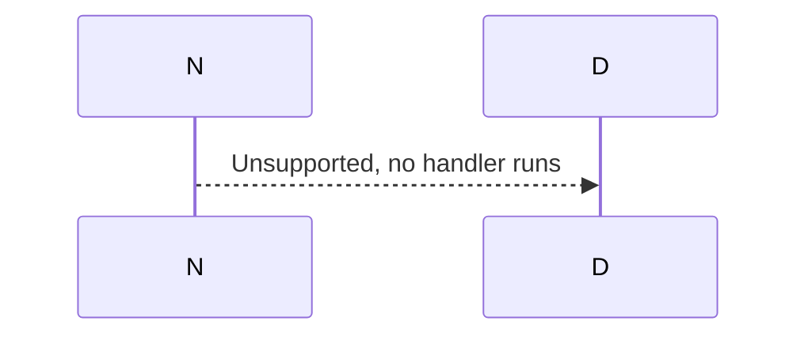
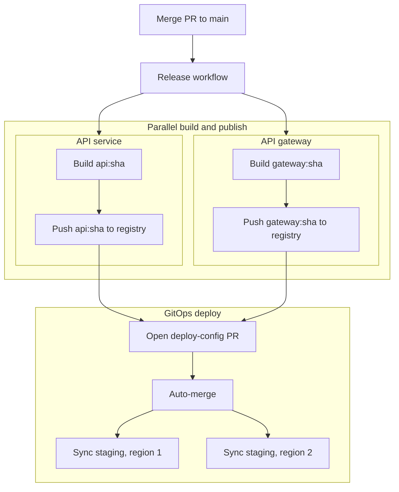

---
paths:
  - '**/*.{mmd,mermaid}'
---

Write Mermaid diagrams that render cleanly and remain readable. Validate every
diagram with Mermaid CLI (`mmdc`) before it goes into a document: generated
diagrams can be invalid or render as an unreadable strip.

## Syntax and layout

Put one statement on each line. Use commas or separate sentences instead of
semicolons in labels, messages, and notes; sequence diagrams treat raw
semicolons as statement separators and can break.



Avoid long, single-column chains such as `A --> B --> C --> D`. Group steps
into `subgraph`s by phase, system, or owner. Draw independent steps side by
side, fanning out and back in, to balance width and depth:



## Validate

Write source to a unique file under `/tmp/` and render it:

```bash
mmdc -i /tmp/diagram-<id>.mmd -o /tmp/diagram-<id>.png
```

A syntax error exits non-zero and names the line. Read the PNG and check that
text is legible, nothing is clipped, and the diagram is not a thin strip. If
`mmdc` is missing, install it with
`npm install -g @mermaid-js/mermaid-cli`.

## Saving an image

Only save an image when the user asks to save one, keep a copy, or put it on
their machine. Previewing or validating alone is not a request to save. When
saving:

1. Write source to `/tmp/mermaid-<id>.mmd` with a fresh random ID; do not
   overwrite an earlier diagram.
2. Add `fontFamily: "Menlo, monospace"` at the top level of the Mermaid init
   config. Mermaid measures text before layout, so setting the font only in
   CSS can clip labels.
3. Use `theme: "base"` with `themeVariables` for global colours. Global
   variables cannot colour subgraphs separately; use `style <subgraph-id>`
   for each boundary and `classDef` with `class` for consistent node boxes.
4. Render with the bundled
   [mermaid.css](../skills/conventions-mermaid/mermaid.css), resolved to an absolute
   path, and a white background:

   ```bash
   id="$(uuidgen | tr '[:upper:]' '[:lower:]')"
   mmdc --input "/tmp/mermaid-${id}.mmd" --output "/tmp/mermaid-${id}.png" \
     --cssFile "$css" --backgroundColor white
   ```

   Add `--scale 2` or `--scale 3` for higher resolution without changing
   layout.
5. Read the image to check legibility and clipping, then give the user its
   exact path. Explain that the PNG does not contain its source, config, or
   CSS; reproduction needs those files and a compatible Mermaid version.
