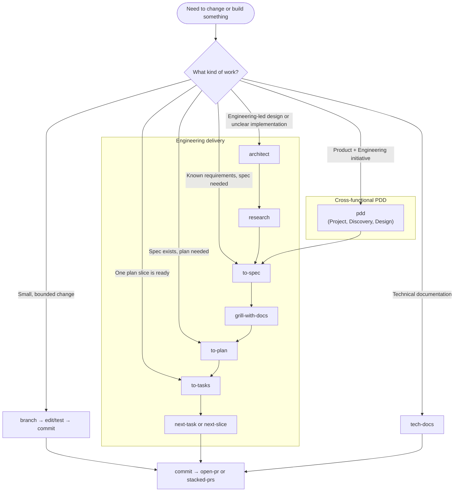
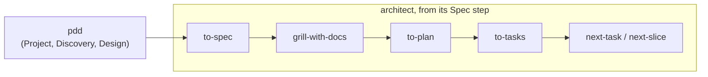

# Agent Skills Configuration

Global configuration for AI coding assistants — skills, agents, rules, and
project instructions shared across every project.

> [!WARNING]
> Some configured skills and plugins are **internal** and will not work for
> everyone. `.claude/settings.json.tmpl` and `.pi/agent/settings.json`
> reference a private repository that is not publicly accessible, so without
> access those entries fail to install. Remove or disable them before running
> the install targets.

> [!NOTE]
> The config templates carry 1Password secret references from an internal
> vault. [`scripts/op-inject.sh`](./scripts/op-inject.sh) resolves them at
> install time and **skips gracefully** when that vault isn't reachable — a
> missing `op` CLI or an unauthenticated account leaves those entries out
> rather than aborting the install.

## Mental model

The repo serves multiple harnesses from one set of files:

- **Claude Code** reads `.claude/` (CLAUDE.md, agents, rules, and a `skills`
  symlink).
- **Generic agents** (e.g. Gemini and OpenCode) read `.agents/` (skills,
  AGENTS.md).
- **Pi** reads `.pi/agent/` for its settings and theme; `make install-pi` also
  copies the shared `AGENTS.md` and installs its configured packages.

Skills have a **single source of truth**: `.agents/skills/`. `.claude/skills`
is a symlink to it, so each skill is edited once and both harnesses see it.
Skill content stays harness-agnostic — generic language ("prompt the user",
"spawn a subagent"). Claude-only guidance lives in a clearly-labeled optional
"Agent teams (if your harness supports it)" section that other harnesses
ignore.

Everything else is a thin adapter around that shared core:

| Asset       | Purpose                                                          |
| ----------- | ---------------------------------------------------------------- |
| `CLAUDE.md` | One-line `@~/.agents/AGENTS.md` import — same conventions        |
| `AGENTS.md` | The canonical global conventions                                 |
| `rules/`    | Path-glob auto-loaded conventions (generic harnesses use skills) |
| `agents/`   | Custom sub-agent definitions spawned via the Task tool           |
| `scripts/`  | Statusline and session-cost helpers                              |

## Install

```bash
# Generic agents only (e.g. Gemini and OpenCode): copies .agents/ to ~/.agents/
make install-agents

# Pi: installs Pi, configured packages, shared instructions, and settings
make install-pi

# Claude Code (pulls in install-agents): copies CLAUDE.md, rules, agents,
# scripts, and mods to ~/.claude/, then symlinks ~/.claude/skills → ~/.agents/skills
make install-claude

# Gemini Antigravity CLI status line (no-op if ~/.gemini/antigravity-cli absent)
make install-gemini

# Copilot CLI status line (no-op if ~/.copilot/scripts absent)
make install-copilot

# OpenCode config, TUI settings, and model preferences
make install-opencode

# Google Workspace MCP server → ~/.local/share/google-workspace-mcp/
make install-google-workspace-mcp

# Everything (install-claude pulls in install-agents; also runs the above)
make install
```

Every target prints one line per action — `✅` done, `💤` skipped because a
prerequisite is missing, `❌` failed. Commands run quietly; a failure prints its
full output and stops the install, so nothing goes wrong silently.

## Maintenance

`make install` checks whether the vendored Google Workspace MCP bundle is behind
the latest upstream stable release and prints a 🔔 line when it is. It never
applies the update itself, because that rewrites tracked files in
`mcp/google-workspace/` and an install shouldn't dirty the working tree. Apply
it when you're ready to commit the bump:

```bash
# Is a newer stable release out? (needs gh)
make check-google-workspace-mcp

# Download it, replace dist/index.js, and bump the recorded ref
make update-google-workspace-mcp

# Re-download the release already vendored
make update-google-workspace-mcp ARGS=--force
```

See [`mcp/google-workspace/README.md`](./mcp/google-workspace/README.md) for what
the update touches and why only stable releases are tracked.

## Structure

```plain
.claude.json.tmpl                   # Global MCP servers (Context7 key templated)

.claude/                            # Claude Code
├── CLAUDE.md                       # @-import pointer to ~/.agents/AGENTS.md
├── agents/                         # Custom sub-agent definitions
├── plugins/                        # Mods → ~/.claude/mods/ (see its README)
├── rules/                          # Conventions auto-loaded by file glob
├── scripts/                        # statusline.sh + session-cost helpers
└── skills -> ../.agents/skills     # Symlink — single source of truth

.gemini/antigravity-cli/            # Gemini Antigravity CLI
└── statusline.sh                   # Status line (mirrors the Claude one)

.copilot/                           # Copilot CLI
├── mcp-config.json.tmpl            # MCP servers (Context7 key templated)
├── settings.json                   # Defaults and TUI settings
└── scripts/statusline.sh           # Status line (mirrors the Claude one)

.config/opencode/                   # OpenCode config
├── config.json.tmpl                # Main config with 1Password secret reference
└── tui.json                        # Notifications and TUI settings

.local/state/opencode/
└── model.json                      # Favorite models and variants

mcp/google-workspace/               # Google Workspace MCP server (all agents)
├── dist/index.js                   # Apache-2.0 upstream bundle (self-contained)
├── launch.sh                       # Self-locating launcher; resolves node
└── gemini-extension.json           # Anchors OAuth token storage to install dir

.pi/agent/                          # Pi configuration
├── settings.json                   # Defaults, enabled models, and packages
└── themes/nord-contrast.json       # Custom Pi theme

.agents/                            # Canonical skills + conventions
├── AGENTS.md                       # Shared conventions
└── skills/                         # One directory per skill (see table below)
    └── shared/                     # Cross-skill policies and references

archive/skills/                     # Retired skills (not installed; see its README)

scripts/                            # Makefile helpers (not installed anywhere)
├── step.sh                         # One status line per install action
├── install-claude-json.sh          # Merges mcpServers into ~/.claude.json
└── workspace-mcp.sh                # Checks for / applies MCP bundle updates
```

## Components

**Pi** — installed by `make install-pi` with the `pi-statusbar`,
`pi-mcp-adapter`, `pi-intercom`, `pi-subagents`, `pi-btw` and `pi-auto-model`
packages. The repository provides a Gemini Flash default, a curated
enabled-model list, hidden thinking blocks, the custom `nord-contrast` theme,
and an `mcp.json` (templated for the Context7 API key) wiring the Atlassian,
fastly, google-workspace, gopls, and Context7 MCP servers.

**Skills** — reusable instructions that extend an agent with a task, pattern, or
specialized knowledge. Depending on frontmatter, agents discover them from the
request or users invoke them explicitly with `/skill-name`. See
[the docs](https://code.claude.com/docs/en/skills).

**[Agents](https://code.claude.com/docs/en/agents)** (`.claude/agents/`) —
specialized sub-agents Claude spawns via the Task tool, each with its own model
and instructions. Current agent: **code-improvement-reviewer** — reviews code
for readability, performance, and best practices with concrete before/after
suggestions.

**[Rules](https://code.claude.com/docs/en/memory#modular-rules-with-claude%2Frules%2F)**
(`.claude/rules/`) — topic-specific instructions Claude loads automatically,
scoped to file patterns via a YAML `paths` glob. Unlike skills, they apply
passively. Generic agents don't support path-scoped auto-loading, so these are
mirrored as skills (`conventions-go`, `conventions-markdown`,
`conventions-mermaid`, `conventions-python`, `conventions-sql`).

**Project instructions** — `.agents/AGENTS.md` holds the canonical conventions;
`.claude/CLAUDE.md` is a one-line `@~/.agents/AGENTS.md` pointer so Claude Code
loads the same set.

## MCP servers

`mcp/google-workspace/` bundles a self-contained Google Workspace MCP server
(Calendar, Drive, Docs, Sheets, Slides, Gmail, Chat, People) usable by any
MCP-capable agent. It's an unmodified Apache-2.0 build of upstream
[`gemini-cli-extensions/workspace`](https://github.com/gemini-cli-extensions/workspace)
— see [`mcp/google-workspace/README.md`](./mcp/google-workspace/README.md) for
provenance, authentication, and update steps.

Claude Code reads its global MCP servers from `~/.claude.json`, a file that also
holds unrelated settings we don't manage. `make install-claude` therefore
codifies only the `mcpServers` block in `.claude.json.tmpl` (Context7 key as a
1Password reference) and installs it with
[`scripts/install-claude-json.sh`](./scripts/install-claude-json.sh). When
`~/.claude.json` is absent the injected template is
copied verbatim; when it exists, `jq` deep-merges our servers over the current
object — our entries win, manually-added servers survive, and every other
setting is left untouched. The merge path needs `jq`.

`make install-google-workspace-mcp` copies it to
`~/.local/share/google-workspace-mcp/`. Agent configs reference that path via
`$HOME`, so nothing is tied to a username. opencode, Gemini CLI, and Pi are
wired automatically (Pi via `.pi/agent/mcp.json.tmpl`, alongside the gopls and
Context7 servers); register it with Claude Code once:

```bash
claude mcp add google-workspace -- \
  bash -c 'exec "$HOME/.local/share/google-workspace-mcp/launch.sh"'
```

Each user authenticates to their own Google account via browser OAuth on first
use; there are no shared credentials.

The **Atlassian** server (Jira, Confluence, Compass) is wired into Pi, Gemini
CLI, Copilot CLI, and OpenCode via their respective config files. Each proxies
the official remote endpoint (`https://mcp.atlassian.com/v1/mcp/authv2`)
through `mcp-remote` with `--transport http-only`, which opens a browser for
OAuth on first run and caches tokens under `~/.mcp-auth` — shared across
harnesses, so you authenticate once (clear with `rm -rf ~/.mcp-auth` to
re-authenticate). Claude Code is intentionally omitted: it reaches Atlassian
through its own connector and the Atlassian plugin.

That endpoint speaks MCP Streamable HTTP. The older HTTP+SSE endpoint
(`https://mcp.atlassian.com/v1/sse`) is deprecated and stops working after
30 June 2026, so `--transport http-only` is explicit: `mcp-remote` defaults to
`http-first`, which silently falls back to SSE on a 404.

The **Portal** server is an internal MCP wired into Claude Code, Pi, Gemini
CLI, Copilot CLI, and OpenCode. Its endpoint URL is a 1Password reference, so
the host name never lands in this public repo. Claude Code uses the native
`http` transport; the others proxy through `mcp-remote`. Either way you
authenticate via SSO on first use.

## Skill reference

| Skill                                                                                      | Description                                                                                              |
| ------------------------------------------------------------------------------------------ | -------------------------------------------------------------------------------------------------------- |
| [**agents-md**](.agents/skills/agents-md/SKILL.md)                                         | Make `AGENTS.md` canonical and point `CLAUDE.md` and `GEMINI.md` to it.                                  |
| [**architect**](.agents/skills/architect/SKILL.md)                                         | Turn an idea into research, a specification, and an implementation plan.                                 |
| [**bcp**](.agents/skills/bcp/SKILL.md)                                                     | Create a branch, commit changes, and open a PR or submit its stack.                                      |
| [**branch**](.agents/skills/branch/SKILL.md)                                               | Create a feature branch named from the current task.                                                     |
| [**changelog**](.agents/skills/changelog/SKILL.md)                                         | Add a changelog entry for uncommitted or branch changes.                                                 |
| [**clarify**](.agents/skills/clarify/SKILL.md)                                             | Resolve ambiguous requirements before work begins.                                                       |
| [**cleanup**](.agents/skills/cleanup/SKILL.md)                                             | Audit AI-generated clutter, then apply approved fixes interactively.                                     |
| [**code-module-design**](.agents/skills/code-module-design/SKILL.md)                       | Design deep modules with high leverage, strong locality, and clean seams.                                |
| [**code-module-review**](.agents/skills/code-module-review/SKILL.md)                       | Map code structure and assess module ownership, boundaries, and interactions.                            |
| [**code-review**](.agents/skills/code-review/SKILL.md)                                     | Review diffs for correctness, security, reliability, performance, and maintainability.                   |
| [**code-review-feedback**](.agents/skills/code-review-feedback/SKILL.md)                   | Verify review feedback before accepting or implementing it.                                              |
| [**commit**](.agents/skills/commit/SKILL.md)                                               | Group related changes and create clear Git commits.                                                      |
| [**conventions-go**](.agents/skills/conventions-go/SKILL.md)                               | Apply Go conventions when editing or reviewing `.go` files.                                              |
| [**conventions-markdown**](.agents/skills/conventions-markdown/SKILL.md)                   | Apply Markdown conventions when editing or reviewing `.md` files.                                        |
| [**conventions-mermaid**](.agents/skills/conventions-mermaid/SKILL.md)                     | Apply Mermaid conventions when creating or editing diagram files or blocks.                              |
| [**conventions-python**](.agents/skills/conventions-python/SKILL.md)                       | Apply Python conventions when editing or reviewing `.py` files.                                          |
| [**conventions-sql**](.agents/skills/conventions-sql/SKILL.md)                             | Apply SQL conventions when editing or creating migration files.                                          |
| [**critique**](.agents/skills/critique/SKILL.md)                                           | Find logical weaknesses in a document and suggest fixes.                                                 |
| [**decide**](.agents/skills/decide/SKILL.md)                                               | Compare consequential options and record a reasoned decision.                                            |
| [**distill**](.agents/skills/distill/SKILL.md)                                             | Shorten long prose without losing essential information.                                                 |
| [**domain-modeling**](.agents/skills/domain-modeling/SKILL.md)                             | Define shared domain language and record architecture decisions.                                         |
| [**durable-rules**](.agents/skills/durable-rules/SKILL.md)                                 | Turn session friction and recurring findings into checks, conventions, or skill changes.                 |
| [**eval**](.agents/skills/eval/SKILL.md)                                                   | Create and run skill evaluations, then compare with the previous run.                                    |
| [**execute-plan**](.agents/skills/execute-plan/SKILL.md)                                   | Compile, delegate, verify, and correct one plan slice at a time without model switching.                 |
| [**explain-code**](.agents/skills/explain-code/SKILL.md)                                   | Explain what code does and why it matters to a newcomer, with a small visual.                            |
| [**fix-failing-tests**](.agents/skills/fix-failing-tests/SKILL.md)                         | Diagnose supplied test failures, then fix them interactively.                                            |
| [**git-metadata**](.agents/skills/git-metadata/SKILL.md)                                   | Analyze Git history for churn, ownership risk, defect clusters, velocity, and crises.                    |
| [**go-testing**](.agents/skills/go-testing/SKILL.md)                                       | Write Go unit, integration, fuzz, and benchmark tests.                                                   |
| [**grill-me**](.agents/skills/grill-me/SKILL.md)                                           | Start a grilling session for a plan, decision, or idea.                                                  |
| [**grill-with-docs**](.agents/skills/grill-with-docs/SKILL.md)                             | Grill an idea while updating its glossary and ADRs.                                                      |
| [**grilling**](.agents/skills/grilling/SKILL.md)                                           | Stress-test assumptions through a structured, relentless interview.                                      |
| [**handoff**](.agents/skills/handoff/SKILL.md)                                             | Summarize the current session for another agent.                                                         |
| [**hunk**](.agents/skills/hunk/SKILL.md)                                                   | Drive a live Hunk TUI session for interactive local and remote PR code reviews.                          |
| [**improve-codebase-architecture**](.agents/skills/improve-codebase-architecture/SKILL.md) | Scan a codebase for deepening opportunities, present a visual HTML report, and grill through candidates. |
| [**incident-report**](.agents/skills/incident-report/SKILL.md)                             | Write an incident report from the session's debugging evidence.                                          |
| [**is-it-safe**](.agents/skills/is-it-safe/SKILL.md)                                       | Assess the worst credible consequence of committing or merging a change.                                 |
| [**jira**](.agents/skills/jira/SKILL.md)                                                   | Create, edit, assign, transition, search, and verify Jira issues.                                        |
| [**llm-stats**](.agents/skills/llm-stats/SKILL.md)                                         | Chart Artificial Analysis LLM benchmarks against cost, tokens, time, and speed as an offline HTML page.  |
| [**model-stats**](.agents/skills/model-stats/SKILL.md)                                     | Chart AI model usage, cost, and effort from local coding-CLI logs as an HTML page.                       |
| [**mutation-testing**](.agents/skills/mutation-testing/SKILL.md)                           | Check whether tests detect behavior changes with deliberate mutations.                                   |
| [**mysql-index-audit**](.agents/skills/mysql-index-audit/SKILL.md)                         | Find MySQL leftmost-prefix violations, index gaps, and unusable indexes.                                 |
| [**next-slice**](.agents/skills/next-slice/SKILL.md)                                       | Implement and complete every task in the next actionable plan slice.                                     |
| [**next-task**](.agents/skills/next-task/SKILL.md)                                         | Implement and complete the next actionable plan or task-list item.                                       |
| [**open-pr**](.agents/skills/open-pr/SKILL.md)                                             | Write and open a concise PR with clear Problem and Solution sections.                                    |
| [**pdd**](.agents/skills/pdd/SKILL.md)                                                     | Run a Product-Engineering initiative through Project, Discovery, and Design approvals.                   |
| [**perspectives**](.agents/skills/perspectives/SKILL.md)                                   | Explore a proposal's evidence, sentiment, risks, benefits, alternatives, and process.                    |
| [**polish**](.agents/skills/polish/SKILL.md)                                               | Improve a short passage's clarity and concision.                                                         |
| [**precedent**](.agents/skills/precedent/SKILL.md)                                         | Align work with patterns established by peer files.                                                      |
| [**recap**](.agents/skills/recap/SKILL.md)                                                 | Summarize what is done, in progress, and next.                                                           |
| [**redesign**](.agents/skills/redesign/SKILL.md)                                           | Plan a simpler rebuild of a feature, subsystem, or codebase, with tests pinned first.                    |
| [**research**](.agents/skills/research/SKILL.md)                                           | Research a topic or repository and save a sourced reference under `docs/research/`.                      |
| [**security-review-feedback**](.agents/skills/security-review-feedback/SKILL.md)           | Validate vulnerability findings for reachability and exploitability before fixing.                       |
| [**show-me**](.agents/skills/show-me/SKILL.md)                                             | Explain a topic visually with concise diagrams, code sketches, and HTML artifacts.                       |
| [**skill-rewrite**](.agents/skills/skill-rewrite/SKILL.md)                                 | Rewrite a skill to be short and readable without losing its core behaviour.                              |
| [**spec-delta**](.agents/skills/spec-delta/SKILL.md)                                       | Record a living-spec behaviour change as a project spec with a Behavioural Delta.                        |
| [**stacked-prs**](.agents/skills/stacked-prs/SKILL.md)                                     | Create and manage dependent PRs with the official `gh stack` extension.                                  |
| [**summarize-for-adhd**](.agents/skills/summarize-for-adhd/SKILL.md)                       | Summarise a session, file, or URL with a clear takeaway and short, ADHD-friendly points.                 |
| [**summarize-for-product**](.agents/skills/summarize-for-product/SKILL.md)                 | Translate engineering changes into a non-technical update.                                               |
| [**systematic-debugging**](.agents/skills/systematic-debugging/SKILL.md)                   | Find root causes through a four-phase debugging workflow.                                                |
| [**talking-points**](.agents/skills/talking-points/SKILL.md)                               | Rank recurring Slack topics from you and your team for a retro or 1:1.                                   |
| [**teach**](.agents/skills/teach/SKILL.md)                                                 | Teach a concept using persistent lessons, missions, and progress records.                                |
| [**teach-with-slides**](.agents/skills/teach-with-slides/SKILL.md)                         | Teach a topic or concept through an educational slide deck.                                              |
| [**tech-docs**](.agents/skills/tech-docs/SKILL.md)                                         | Write or improve concise, maintainable technical documentation.                                          |
| [**to-adr**](.agents/skills/to-adr/SKILL.md)                                               | Extract genuine architecture decisions into standalone ADRs.                                             |
| [**to-plan**](.agents/skills/to-plan/SKILL.md)                                             | Write a plan of vertical slices, outcome milestones, dependencies, and PR grouping.                      |
| [**to-prd**](.agents/skills/to-prd/SKILL.md)                                               | Extract product goals, scope, and success measures into a PRD.                                           |
| [**to-spec**](.agents/skills/to-spec/SKILL.md)                                             | Write an implementation-ready feature spec with scope and acceptance criteria.                           |
| [**to-tasks**](.agents/skills/to-tasks/SKILL.md)                                           | Compile a plan slice into a mechanical TDD task document with verbatim code.                             |
| [**unslop**](.agents/skills/unslop/SKILL.md)                                               | Cut AI tells and machine cadence from prose to restore human voice.                                      |
| [**voice-adhd**](.agents/skills/voice-adhd/SKILL.md)                                       | Reply in an ADHD-friendly shape once, or for the whole session with `--all`.                             |
| [**voice-integralist**](.agents/skills/voice-integralist/SKILL.md)                         | Write in Integralist's voice once, or for the whole session with `--all`.                                |
| [**voice-product**](.agents/skills/voice-product/SKILL.md)                                 | Write in a plain, audience-first voice once, or for the whole session with `--all`.                      |
| [**wait-what**](.agents/skills/wait-what/SKILL.md)                                         | Re-pitch a message that did not land.                                                                    |
| [**writing-for-agents**](.agents/skills/writing-for-agents/SKILL.md)                       | Apply conventions that make skills and instruction files predictable.                                    |

## Developer workflows

This guide helps developers choose a workflow from the skills in this
repository. Start with the narrowest workflow that matches the work; do not
wrap a small change in the full architecture process.

### Choose a starting point



Use `pdd` when Product and Engineering need to agree on an initiative's scope,
milestones, solution direction, and system-level design before implementation.
Use `architect` for an engineering-led workflow that needs research, a stable
specification, design stress-testing, and an implementation plan. Use the
narrower skills when those inputs already exist.

### PDD and engineering handoff

PDD documents answer cross-functional approval questions. Engineering
artifacts translate the approved Design into executable work:



The arrows above show skill handoffs; the outputs are separate artifacts:

| Skill                      | Produces or updates                         |
| -------------------------- | ------------------------------------------- |
| `pdd`                      | `project.md`, `discovery*.md`, `design*.md` |
| `to-spec`                  | `spec.md`                                   |
| `to-plan`                  | `plan.md`                                   |
| `to-tasks`                 | `tasks.md` or `tasks-slice-N.md`            |
| `next-task` / `next-slice` | Task checkboxes and implementation changes  |

The Design document is not the same artifact as `plan.md`:

| Artifact           | Main question                      | Audience              |
| ------------------ | ---------------------------------- | --------------------- |
| `project.md`       | What are we doing, why, and when?  | Product + Engineering |
| `discovery-mN.md`  | Which option should we choose?     | Product + Engineering |
| `design-mN.md`     | What solution are we approving?    | Product + Engineering |
| `spec.md`          | What behavior is required?         | Engineering           |
| `plan.md`          | How will engineering implement it? | Implementers          |
| `tasks-slice-N.md` | What exact work happens next?      | Implementer           |

For a first or single-milestone PDD project, use `discovery.md` and `design.md`.
When a second milestone is introduced, rename the existing files to
`discovery-m1.md` and `design-m1.md`, create the milestone-two files, and update
all links in the project README. If multiple milestones are known up front, use
qualified names from the beginning.

After Design is approved, pdd hands off to `architect` from its Spec step, so
research and bootstrap are skipped.

### Project workspaces

Every project under `projects/<project>/` has a `README.md` index. The index
links the project artifacts, records their current status, and names the next
action. Skills that create or execute project artifacts keep it current using
[`PROJECT-README.md`](./.agents/skills/shared/PROJECT-README.md).

The parent [`projects/README.md`](./.agents/skills/shared/PROJECTS-README.md)
describes the shared project lifecycle. The project-local README is the source
for that project's navigation and status; `spec.md`, `plan.md`, and the other
artifacts remain the sources for their own content. PDD documents use the
canonical [Project](./.agents/skills/shared/PDD-PROJECT-TEMPLATE.md),
[Discovery](./.agents/skills/shared/PDD-DISCOVERY-TEMPLATE.md), and
[Design](./.agents/skills/shared/PDD-DESIGN-TEMPLATE.md) templates.

Current behaviour lives in living specs under `docs/specs/`; completed projects
keep the history of how it changed. Every behaviour edit to a living spec goes
through **spec-delta**, which records it as a project spec with a Behavioural
Delta. **code-review** checks both kinds of spec whenever a diff touches them.

## Choosing an analysis skill

| Skill                                                                | Use when                                                                           | Primary output                                                                     |
| -------------------------------------------------------------------- | ---------------------------------------------------------------------------------- | ---------------------------------------------------------------------------------- |
| [**code-module-review**](.agents/skills/code-module-review/SKILL.md) | Understand a feature's structure and assess module ownership                       | Mermaid maps and evidence-backed findings                                          |
| [**code-review**](.agents/skills/code-review/SKILL.md)               | Code or a diff exists and you want defects identified                              | Verified findings and open questions                                               |
| [**explain-code**](.agents/skills/explain-code/SKILL.md)             | You are new to the repo and want to understand what code does and why it is useful | Concise Problem/Solution explanation, visual, and optional PR-author clarification |
| [**is-it-safe**](.agents/skills/is-it-safe/SKILL.md)                 | You need the worst credible outcome of committing or merging a change              | Verdict and evidence-backed impact path                                            |
| [**precedent**](.agents/skills/precedent/SKILL.md)                   | Work is correct and you want it to match the project's own patterns                | Divergences citing the peer that sets each pattern                                 |
| [**decide**](.agents/skills/decide/SKILL.md)                         | You must choose between consequential options                                      | Durable decision memo and recommendation                                           |
| [**perspectives**](.agents/skills/perspectives/SKILL.md)             | You want quick breadth, brainstorming, or a structured "what are we missing?" pass | Multi-perspective analysis and next step                                           |

Common sequences:

- Unclear problem space: **perspectives** → **decide**
- Consequential engineering choice: **decide**
- Understand a PR, commit, or local code before reviewing: **explain-code**
- Find defects in a pull request or local diff: **code-review**
- New code that works but may not look like its neighbours: **precedent**
- Quick meeting or brainstorming pass: **perspectives**

## Claude-specific frontmatter

Skill bodies are harness-agnostic, but some YAML frontmatter keys are read only
by Claude Code. They're safe in shared skills — other harnesses ignore unknown
keys.

| Field                      | Where        | Purpose                                                             |
| -------------------------- | ------------ | ------------------------------------------------------------------- |
| `user-invocable`           | `SKILL.md`   | Exposes the skill as a `/skill-name` slash command                  |
| `argument-hint`            | `SKILL.md`   | Placeholder text shown after the slash command in the prompt        |
| `allowed-tools`            | `SKILL.md`   | Pre-approves specific tool calls (e.g. `Bash(git diff:*)`)          |
| `disable-model-invocation` | `SKILL.md`   | Prevents auto-invocation; user must call the skill explicitly       |
| `arguments`                | `SKILL.md`   | Structured argument definitions for a slash command                 |
| `paths`                    | `rules/*.md` | Glob patterns that auto-load a rule when matching files are touched |

## Generating rules from skills

`.claude/rules/go.md`, `.claude/rules/markdown.md`,
`.claude/rules/mermaid.md`, `.claude/rules/python.md`, and
`.claude/rules/sql.md` are **generated** from the `conventions-go`,
`conventions-markdown`, `conventions-mermaid`, `conventions-python`, and
`conventions-sql` skills. The `SKILL.md` is the single source of truth; the rule
differs only by frontmatter (`paths:` globs in place of `name:`/`description:`),
and the bodies stay byte-identical.

Regenerate with `make rules` (runs `.claude/scripts/gen-rules.sh`); `make install` runs it automatically. After editing a `conventions-*` skill, run `make rules` before committing — the generated rules are committed.

## Workflow

Use one of these flows:

```txt
Product: pdd (Project, Discovery, Design)
       → architect (spec, grill, plan) → to-tasks → next-task / next-slice

Engineering: architect (research, spec, grill, plan)
       → to-tasks → next-task / next-slice → commit → code-review
```

`pdd` is the Product-Engineering approval workflow. After Design is approved,
`to-spec` translates the cross-functional decision into stable engineering
behavior. `to-plan` then turns that behavior into vertical implementation
slices.

`architect` is the engineering-led alternative. It coordinates research,
`to-spec`, design stress-testing, and `to-plan` when a PDD process is not the
right fit.

Plans track coarse outcomes under `Slice N Milestones` with stable keys such
as `M1.1`, not executable `Task N.N` steps. Precise interfaces, dependencies,
and approved design choices remain in the plan or linked design/spec; full
acceptance criteria live in the spec. `to-tasks` inspects that context and live
code, then compiles the selected slice into mechanical TDD tasks. Each task's
`Supports` field maps to source milestones; several tasks may support one
milestone, and one task may support several. Task IDs and commits stay separate
from milestone IDs. The task document contains files, tests/code, and commands;
`execution.md` records outcome evidence, mappings, and implementation history.
See [workflow terminology](./GLOSSARY.md).

`next-task` or `next-slice` executes compiled tasks in the main thread, or
performs inline TDD from plan outcomes in manual mode. Existing plans with
legacy `Task N.N` checkboxes remain valid; preserve their labels/state rather
than renumbering them. Plan milestones are checked only after outcome
verification, not because a similarly numbered task finished.

### Automated plan execution

After either workflow produces a plan, keep your premium session open and run:

```text
Pi:          /skill:execute-plan projects/<date>-<slug>/plan.md
Claude Code: /execute-plan projects/<date>-<slug>/plan.md
```

[`execute-plan`](./.agents/skills/execute-plan/SKILL.md) has a premium subagent
write the task list for only the next unblocked slice and delegates one task at
a time to a cheap subagent, both on the session's provider. The premium
coordinator inspects each task's actual changes,
runs checks, and commits its tests, implementation, and required documentation
together before assigning another task. It reviews the whole slice before
compiling the next one. Later review fixes receive separate correction commits.
The selected session model owns decisions, commits, and final review. It
records evidence and task-to-commit mappings in `execution.md` beside the plan,
protects existing work, and displays every commit's short hash and title,
grouped by slice and task, when reporting completion or a blocker.
The [model policy](./.agents/skills/shared/EXECUTION-MODELS.md) configures Luna
for Pi/Copilot and Haiku for Claude Code, both at `xhigh`, never `max`.

Add `auto` after the plan path to keep going without routine confirmations:

```text
/skill:execute-plan projects/<date>-<slug>/plan.md auto
```

Auto mode authorizes in-scope local edits, configured workers, and task/status
commits through all slices and the final audit. The coordinator resolves missing
detail within the plan's constraints and records each judgment, alternatives,
rationale, impact, and validation in `execution.md`, with a complete decision
index in the final or blocked report. Default mode remains interactive. Auto
still stops for real blockers, required fresh-per-diff approvals, unavailable
checks/models, unsafe staging, or exhausted retries. It never pushes, deploys,
publishes, or submits PRs. Re-supply `auto` when starting a new invocation;
a prior log does not silently opt you back in. See
[auto authority and decision logging](./.agents/skills/execute-plan/references/auto.md).

Install the shared skill with `make install-agents`. Pi also needs the updated
`pi-subagents` extension exposing `allow_model_fallback`; see its
[adapter setup](./.agents/skills/execute-plan/references/pi-subagents.md).
Claude Code needs the [plan-executor](./.claude/agents/plan-executor.md) definition
installed through `make install-claude`; see its
[model checks](./.agents/skills/execute-plan/references/claude-code.md).
Native model/effort substitutions or unavailable telemetry can block execution.
PDD approvals, permissions, and separately authorized delivery operations
remain explicit gates. Interactive startup confirmation or explicit auto
consent authorizes coordinator-owned per-task and evidence/status commits on
the named branch; the workflow never pushes or deploys. Manual `next-slice`
keeps one commit per slice.
See [task-commit safety and review indexing](./.agents/skills/execute-plan/references/task-commits.md).

`to-tasks` keeps its manual invocation behavior; the coordinator follows its
`SKILL.md` as a plain file, and workers follow
[the worker procedure](./.agents/skills/execute-plan/references/worker.md). Validate
wiring and model-definition consistency with `make check-execute-plan`. The
bundled simulations exercise workflow decisions, not live provider execution;
see [validation results](./.agents/skills/execute-plan/evals/RESULTS.md) for
coverage and limits.

Plans and task lists can group several tasks into each review unit. When those
units depend on each other, **stacked-prs** creates and manages the branches and
PRs with `gh stack`.

Optional branches:

- **critique** — review a plan or document before implementation
- **cleanup** — remove AI-generated clutter
- **redesign** — plan a simpler rebuild of a feature, subsystem, or codebase

## Contributing

1. Ensure additions are truly **global** — applicable across multiple projects.
1. Write clear, concise descriptions so agents interpret them accurately.
1. Include examples where helpful; avoid project-specific details.
1. Add new skills under `.agents/skills/<name>/` only — the `.claude/skills`
   symlink picks them up. Keep content harness-agnostic; put Claude-only
   guidance in an optional "Agent teams (if your harness supports it)" section.
1. Test with Claude to confirm the desired behavior.

## License

Personal coding skills and preferences. Feel free to use and adapt them for your
own projects.
