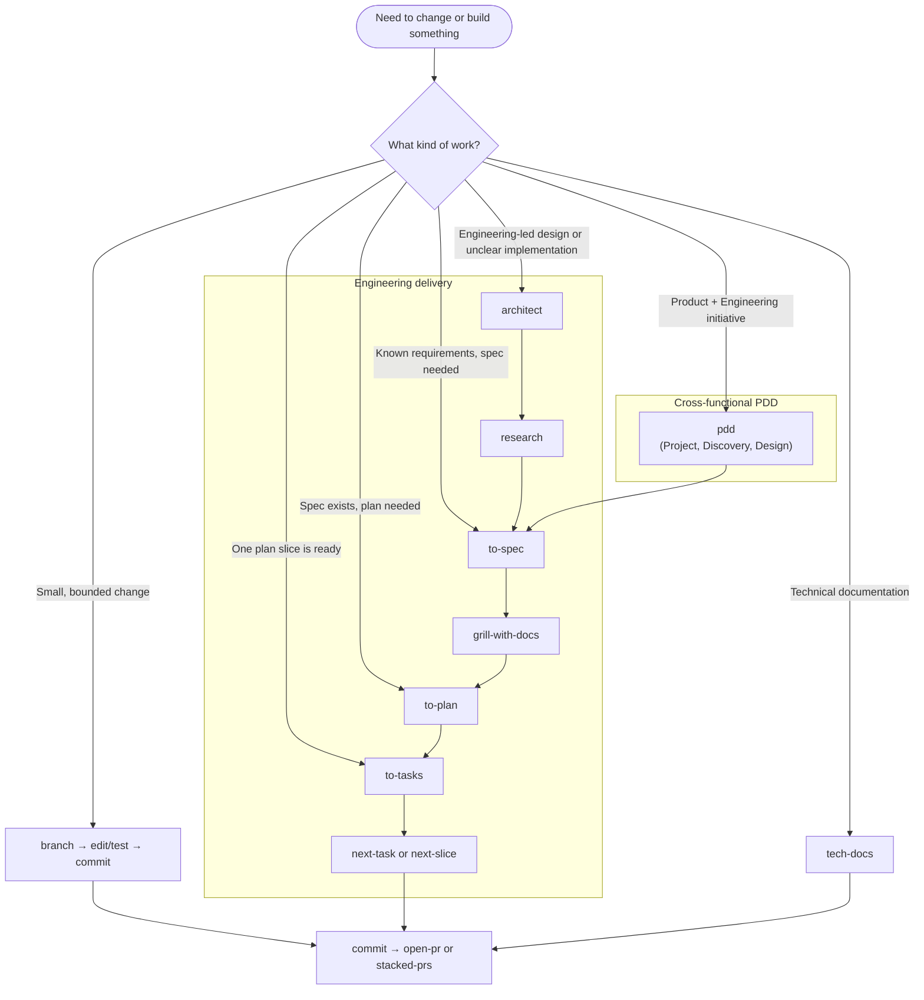

# Agent Skills Configuration

Shared skills, agents, rules, and configuration for multiple AI coding
assistants.

For more information see: \
https://www.integralist.co.uk/posts/how-i-use-ai/

> [!NOTE]
> `.claude/skills` is a symlink to `.agents/skills/` so each skill only needs to
> be edited in one place, while supporting both harness types and keeping skill
> language neutral.

## Skill reference

| Skill                                                                                      | Description                                                                                              |
| ------------------------------------------------------------------------------------------ | -------------------------------------------------------------------------------------------------------- |
| [**acp**](.agents/skills/acp/SKILL.md)                                                     | Approve the current change, commit it to `main`, and push to `origin`.                                   |
| [**agents-md**](.agents/skills/agents-md/SKILL.md)                                         | Make `AGENTS.md` canonical and point `CLAUDE.md` and `GEMINI.md` to it.                                  |
| [**architect**](.agents/skills/architect/SKILL.md)                                         | Turn an idea into research, a specification, and an implementation plan.                                 |
| [**bcp**](.agents/skills/bcp/SKILL.md)                                                     | Create a branch, commit changes, and open a PR or submit its stack.                                      |
| [**branch**](.agents/skills/branch/SKILL.md)                                               | Create a feature branch named from the current task.                                                     |
| [**changelog**](.agents/skills/changelog/SKILL.md)                                         | Add a changelog entry for uncommitted or branch changes.                                                 |
| [**clarify**](.agents/skills/clarify/SKILL.md)                                             | Resolve ambiguous requirements before work begins.                                                       |
| [**cleanup**](.agents/skills/cleanup/SKILL.md)                                             | Audit AI-generated clutter, then apply approved fixes interactively.                                     |
| [**code-module-design**](.agents/skills/code-module-design/SKILL.md)                       | Design deep modules with high leverage, strong locality, and clean seams.                                |
| [**code-module-review**](.agents/skills/code-module-review/SKILL.md)                       | Map code structure and assess module ownership, boundaries, and interactions.                            |
| [**code-review**](.agents/skills/code-review/SKILL.md)                                     | Review diffs for correctness, security, reliability, performance, and maintainability.                   |
| [**code-review-feedback**](.agents/skills/code-review-feedback/SKILL.md)                   | Verify review feedback before accepting or implementing it.                                              |
| [**commit**](.agents/skills/commit/SKILL.md)                                               | Group related changes and create clear Git commits.                                                      |
| [**conventions-acceptance-tests**](.agents/skills/conventions-acceptance-tests/SKILL.md)   | Keep Go/Godog and Make/Bash acceptance tests aligned with feature scenarios.                             |
| [**conventions-go**](.agents/skills/conventions-go/SKILL.md)                               | Apply Go conventions when editing or reviewing `.go` files.                                              |
| [**conventions-markdown**](.agents/skills/conventions-markdown/SKILL.md)                   | Apply Markdown conventions when editing or reviewing `.md` files.                                        |
| [**conventions-mermaid**](.agents/skills/conventions-mermaid/SKILL.md)                     | Apply Mermaid conventions when creating or editing diagram files or blocks.                              |
| [**conventions-python**](.agents/skills/conventions-python/SKILL.md)                       | Apply Python conventions when editing or reviewing `.py` files.                                          |
| [**conventions-sql**](.agents/skills/conventions-sql/SKILL.md)                             | Apply SQL conventions when editing or creating migration files.                                          |
| [**critique**](.agents/skills/critique/SKILL.md)                                           | Find logical weaknesses in a document and suggest fixes.                                                 |
| [**decide**](.agents/skills/decide/SKILL.md)                                               | Compare consequential options and record a reasoned decision.                                            |
| [**design**](.agents/skills/design/SKILL.md)                                               | Apply shared Anthropic- or Fastly-inspired themes to visual work, with switchable HTML light/dark mode.  |
| [**distill**](.agents/skills/distill/SKILL.md)                                             | Shorten long prose without losing essential information.                                                 |
| [**domain-modeling**](.agents/skills/domain-modeling/SKILL.md)                             | Define shared domain language and record architecture decisions.                                         |
| [**durable-rules**](.agents/skills/durable-rules/SKILL.md)                                 | Turn session friction and recurring findings into checks, conventions, or skill changes.                 |
| [**eval**](.agents/skills/eval/SKILL.md)                                                   | Create and run skill evaluations, then compare with the previous run.                                    |
| [**execute-plan**](.agents/skills/execute-plan/SKILL.md)                                   | Compile, delegate, verify, and correct one plan slice at a time without model switching.                 |
| [**explain-code**](.agents/skills/explain-code/SKILL.md)                                   | Explain what code does and why it matters to a newcomer, with a small visual.                            |
| [**fix-failing-tests**](.agents/skills/fix-failing-tests/SKILL.md)                         | Diagnose supplied test failures, then fix them interactively.                                            |
| [**git-metadata**](.agents/skills/git-metadata/SKILL.md)                                   | Analyze Git history for churn, ownership risk, defect clusters, velocity, and crises.                    |
| [**go-testing**](.agents/skills/go-testing/SKILL.md)                                       | Write Go unit, integration, fuzz, and benchmark tests.                                                   |
| [**grill-me**](.agents/skills/grill-me/SKILL.md)                                           | Start a grilling session for a plan, decision, or idea.                                                  |
| [**grill-with-docs**](.agents/skills/grill-with-docs/SKILL.md)                             | Grill an idea while updating its glossary and ADRs.                                                      |
| [**grilling**](.agents/skills/grilling/SKILL.md)                                           | Stress-test assumptions through a structured, relentless interview.                                      |
| [**handoff**](.agents/skills/handoff/SKILL.md)                                             | Summarize the current session for another agent.                                                         |
| [**hunk**](.agents/skills/hunk/SKILL.md)                                                   | Drive a live Hunk TUI session for interactive local and remote PR code reviews.                          |
| [**improve-codebase-architecture**](.agents/skills/improve-codebase-architecture/SKILL.md) | Scan a codebase for deepening opportunities, present a visual HTML report, and grill through candidates. |
| [**incident-report**](.agents/skills/incident-report/SKILL.md)                             | Write an incident report from the session's debugging evidence.                                          |
| [**is-it-safe**](.agents/skills/is-it-safe/SKILL.md)                                       | Assess the worst credible consequence of committing or merging a change.                                 |
| [**jira**](.agents/skills/jira/SKILL.md)                                                   | Create, edit, assign, transition, search, and verify Jira issues.                                        |
| [**llm-stats**](.agents/skills/llm-stats/SKILL.md)                                         | Chart Artificial Analysis LLM benchmarks against cost, tokens, time, and speed as an offline HTML page.  |
| [**model-stats**](.agents/skills/model-stats/SKILL.md)                                     | Chart AI model usage, cost, and effort from local coding-CLI logs as an HTML page.                       |
| [**mutation-testing**](.agents/skills/mutation-testing/SKILL.md)                           | Check whether tests detect behavior changes with deliberate mutations.                                   |
| [**mysql-index-audit**](.agents/skills/mysql-index-audit/SKILL.md)                         | Find MySQL leftmost-prefix violations, index gaps, and unusable indexes.                                 |
| [**next-slice**](.agents/skills/next-slice/SKILL.md)                                       | Implement and complete every task in the next actionable plan slice.                                     |
| [**next-task**](.agents/skills/next-task/SKILL.md)                                         | Implement and complete the next actionable plan or task-list item.                                       |
| [**open-pr**](.agents/skills/open-pr/SKILL.md)                                             | Write and open a concise PR with clear Problem and Solution sections.                                    |
| [**pdd**](.agents/skills/pdd/SKILL.md)                                                     | Run a Product-Engineering initiative through Project, Discovery, and Design approvals.                   |
| [**perspectives**](.agents/skills/perspectives/SKILL.md)                                   | Explore a proposal's evidence, sentiment, risks, benefits, alternatives, and process.                    |
| [**polish**](.agents/skills/polish/SKILL.md)                                               | Improve a short passage's clarity and concision.                                                         |
| [**precedent**](.agents/skills/precedent/SKILL.md)                                         | Align work with patterns established by peer files.                                                      |
| [**recap**](.agents/skills/recap/SKILL.md)                                                 | Summarize what is done, in progress, and next.                                                           |
| [**redesign**](.agents/skills/redesign/SKILL.md)                                           | Plan a simpler rebuild of a feature, subsystem, or codebase, with tests pinned first.                    |
| [**research**](.agents/skills/research/SKILL.md)                                           | Research a topic or repository and save a sourced reference under `docs/research/`.                      |
| [**security-review-feedback**](.agents/skills/security-review-feedback/SKILL.md)           | Validate vulnerability findings for reachability and exploitability before fixing.                       |
| [**show-me**](.agents/skills/show-me/SKILL.md)                                             | Explain a topic visually with concise diagrams, code sketches, and HTML artifacts.                       |
| [**skill-rewrite**](.agents/skills/skill-rewrite/SKILL.md)                                 | Rewrite a skill to be short and readable without losing its core behaviour.                              |
| [**spec-delta**](.agents/skills/spec-delta/SKILL.md)                                       | Record a living-spec behaviour change as a project spec with a Behavioural Delta.                        |
| [**stacked-prs**](.agents/skills/stacked-prs/SKILL.md)                                     | Create and manage dependent PRs with the official `gh stack` extension.                                  |
| [**summarize-for-adhd**](.agents/skills/summarize-for-adhd/SKILL.md)                       | Summarise a session, file, or URL with a clear takeaway and short, ADHD-friendly points.                 |
| [**summarize-for-product**](.agents/skills/summarize-for-product/SKILL.md)                 | Translate engineering changes into a non-technical update.                                               |
| [**systematic-debugging**](.agents/skills/systematic-debugging/SKILL.md)                   | Find root causes through a four-phase debugging workflow.                                                |
| [**talking-points**](.agents/skills/talking-points/SKILL.md)                               | Rank recurring Slack topics from you and your team for a retro or 1:1.                                   |
| [**teach**](.agents/skills/teach/SKILL.md)                                                 | Teach a concept using persistent lessons, missions, and progress records.                                |
| [**teach-with-slides**](.agents/skills/teach-with-slides/SKILL.md)                         | Teach a topic or concept through an educational slide deck.                                              |
| [**tech-docs**](.agents/skills/tech-docs/SKILL.md)                                         | Write or improve concise, maintainable technical documentation.                                          |
| [**to-adr**](.agents/skills/to-adr/SKILL.md)                                               | Extract genuine architecture decisions into standalone ADRs.                                             |
| [**to-plan**](.agents/skills/to-plan/SKILL.md)                                             | Write a plan of vertical slices, outcome milestones, dependencies, and PR grouping.                      |
| [**to-prd**](.agents/skills/to-prd/SKILL.md)                                               | Extract product goals, scope, and success measures into a PRD.                                           |
| [**to-spec**](.agents/skills/to-spec/SKILL.md)                                             | Write an implementation-ready feature spec with scope and acceptance criteria.                           |
| [**to-tasks**](.agents/skills/to-tasks/SKILL.md)                                           | Compile a plan slice into a mechanical TDD task document with verbatim tests.                            |
| [**unslop**](.agents/skills/unslop/SKILL.md)                                               | Cut AI tells and machine cadence from prose to restore human voice.                                      |
| [**voice-adhd**](.agents/skills/voice-adhd/SKILL.md)                                       | Reply in an ADHD-friendly shape once, or for the whole session with `--all`.                             |
| [**voice-integralist**](.agents/skills/voice-integralist/SKILL.md)                         | Write in Integralist's voice once, or for the whole session with `--all`.                                |
| [**voice-product**](.agents/skills/voice-product/SKILL.md)                                 | Write in a plain, audience-first voice once, or for the whole session with `--all`.                      |
| [**wait-what**](.agents/skills/wait-what/SKILL.md)                                         | Re-pitch a message that did not land.                                                                    |
| [**writing-for-agents**](.agents/skills/writing-for-agents/SKILL.md)                       | Apply conventions that make skills and instruction files predictable.                                    |

## Install

> [!WARNING]
> Some configured skills and plugins are **internal** and will not work for
> everyone. `.claude/settings.json.tmpl` and `.pi/agent/settings.json`
> reference a private repository that is not publicly accessible, so without
> access those entries fail to install. Remove or disable them before running
> the install targets.

> [!NOTE]
> The config templates carry 1Password secret references from an internal
> vault. [`scripts/op-inject.sh`](./scripts/op-inject.sh) resolves them at
> install time and **skips gracefully** when that vault isn't reachable — a
> missing `op` CLI or an unauthenticated account leaves those entries out
> rather than aborting the install.

```bash
# Generic agents only (e.g. Gemini and OpenCode): copies .agents/ to ~/.agents/
make install-agents

# Pi: installs Pi, configured packages, shared instructions, and settings
make install-pi

# Claude Code (pulls in install-agents): copies CLAUDE.md, rules, agents,
# scripts, and mods to ~/.claude/, then symlinks ~/.claude/skills → ~/.agents/skills
make install-claude

# Gemini Antigravity CLI status line (no-op if ~/.gemini/antigravity-cli absent)
make install-gemini

# Copilot CLI status line (no-op if ~/.copilot/scripts absent)
make install-copilot

# OpenCode config, TUI settings, and model preferences
make install-opencode

# Google Workspace MCP server → ~/.local/share/google-workspace-mcp/
make install-google-workspace-mcp

# Everything (install-claude pulls in install-agents; also runs the above)
make install
```

## Developer workflows

This guide helps developers choose a workflow from the skills in this
repository. Start with the narrowest workflow that matches the work; do not
wrap a small change in the full architecture process.

### Choose a starting point



Use `pdd` when Product and Engineering need to agree on an initiative's scope,
milestones, solution direction, and system-level design before implementation.
Use `architect` for an engineering-led workflow that needs research, a stable
specification, design stress-testing, and an implementation plan. Use the
narrower skills when those inputs already exist.

| Skill                      | Produces or updates                         |
| -------------------------- | ------------------------------------------- |
| `pdd`                      | `project.md`, `discovery*.md`, `design*.md` |
| `to-spec`                  | `spec.md`                                   |
| `to-plan`                  | `plan.md`                                   |
| `to-tasks`                 | `tasks.md` or `tasks-slice-N.md`            |
| `next-task` / `next-slice` | Task checkboxes and implementation changes  |

The Design document is not the same artifact as `plan.md`:

| Artifact           | Main question                      | Audience              |
| ------------------ | ---------------------------------- | --------------------- |
| `project.md`       | What are we doing, why, and when?  | Product + Engineering |
| `discovery-mN.md`  | Which option should we choose?     | Product + Engineering |
| `design-mN.md`     | What solution are we approving?    | Product + Engineering |
| `spec.md`          | What behavior is required?         | Engineering           |
| `plan.md`          | How will engineering implement it? | Implementers          |
| `tasks-slice-N.md` | What exact work happens next?      | Implementer           |

## Choosing an analysis skill

| Skill                                                                | Use when                                                                           | Primary output                                                                     |
| -------------------------------------------------------------------- | ---------------------------------------------------------------------------------- | ---------------------------------------------------------------------------------- |
| [**code-module-review**](.agents/skills/code-module-review/SKILL.md) | Understand a feature's structure and assess module ownership                       | Mermaid maps and evidence-backed findings                                          |
| [**code-review**](.agents/skills/code-review/SKILL.md)               | Code or a diff exists and you want defects identified                              | Verified findings and open questions                                               |
| [**explain-code**](.agents/skills/explain-code/SKILL.md)             | You are new to the repo and want to understand what code does and why it is useful | Concise Problem/Solution explanation, visual, and optional PR-author clarification |
| [**is-it-safe**](.agents/skills/is-it-safe/SKILL.md)                 | You need the worst credible outcome of committing or merging a change              | Verdict and evidence-backed impact path                                            |
| [**precedent**](.agents/skills/precedent/SKILL.md)                   | Work is correct and you want it to match the project's own patterns                | Divergences citing the peer that sets each pattern                                 |
| [**decide**](.agents/skills/decide/SKILL.md)                         | You must choose between consequential options                                      | Durable decision memo and recommendation                                           |
| [**perspectives**](.agents/skills/perspectives/SKILL.md)             | You want quick breadth, brainstorming, or a structured "what are we missing?" pass | Multi-perspective analysis and next step                                           |

Common sequences:

- Unclear problem space: **perspectives** → **decide**
- Consequential engineering choice: **decide**
- Understand a PR, commit, or local code before reviewing: **explain-code**
- Find defects in a pull request or local diff: **code-review**
- New code that works but may not look like its neighbours: **precedent**
- Quick meeting or brainstorming pass: **perspectives**

## Skill frontmatter

Skill bodies are harness-agnostic, but some YAML frontmatter keys are read only
by Claude Code. They're safe in shared skills — other harnesses ignore unknown
keys.

| Field                      | Where        | Purpose                                                             |
| -------------------------- | ------------ | ------------------------------------------------------------------- |
| `user-invocable`           | `SKILL.md`   | Exposes the skill as a `/skill-name` slash command                  |
| `argument-hint`            | `SKILL.md`   | Placeholder text shown after the slash command in the prompt        |
| `allowed-tools`            | `SKILL.md`   | Pre-approves specific tool calls (e.g. `Bash(git diff:*)`)          |
| `disable-model-invocation` | `SKILL.md`   | Prevents auto-invocation; user must call the skill explicitly       |
| `arguments`                | `SKILL.md`   | Structured argument definitions for a slash command                 |
| `paths`                    | `rules/*.md` | Glob patterns that auto-load a rule when matching files are touched |
